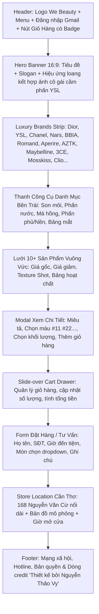

# Kế Hoạch Triển Khai Landing Page Mỹ Phẩm Chính Hãng "We Beauty Cần Thơ"

## 1. Mục Tiêu Dự Án (Goal Description)
Xây dựng và hoàn thiện website landing page bán hàng online hiện đại, tối giản và cao cấp cho cửa hàng mỹ phẩm chính hãng **We Beauty** tại **168, Nguyễn Văn Cừ nối dài, Cần Thơ** (Hotline: **0833347677**).

Website được thiết kế mang phong cách thẩm mỹ tinh tế (Aesthetic Beauty Editorial):
- **Tông màu chủ đạo**: Hồng nhạt (`#FFF0F3`, `#FCE7F3`), Be ấm (`#FAF6F0`, `#F5EBE0`), Trắng ngọc trai (`#FFFFFF`) kết hợp điểm nhấn Rose Gold (`#C5A880`) và Vàng hoàng gia (`#D4AF37`).
- **Typography & Layout**: Font không chân hiện đại (*Montserrat*, *Inter*, *Be Vietnam Pro*), tận dụng tối đa khoảng trắng (white space), bố cục lưới vuông vức, cận cảnh kết cấu mỹ phẩm (texture shots) và bảng hoạt chất thành phần (Active Ingredients).
- **Trải nghiệm mua sắm**: Đăng nhập Gmail, giỏ hàng tương tác (Slide-out Cart), thanh công cụ danh mục bên trái, popup xem chi tiết miêu tả sản phẩm và chọn biến thể (màu sắc, khối lượng, phân loại), form đặt hàng tự động đồng bộ giỏ hàng, và credit designer **"Thiết kế bởi Nguyễn Thảo Vy"**.

---

## 2. Phân Tích & Đối Chiếu Yêu Cầu Chi Tiết

---

## 3. Các Tính Năng Cần Bổ Sung & Nâng Cấp Cụ Thể

### A. Header: Đăng Nhập Gmail & Giỏ Hàng Tương Tác
- **Nút "Đăng nhập Gmail"**:
  - Đặt tại góc phải header.
  - Nhấp mở modal đăng nhập Google chuẩn thương hiệu (nút *Sign in with Google*, nhập email, hiển thị avatar người dùng & tên tài khoản sau khi đăng nhập thành công: ví dụ `Thảo Vy (thaovy@gmail.com)`).
- **Nút "Giỏ hàng" (Shopping Cart Drawer)**:
  - Hiển thị biểu tượng túi mua sắm thanh lịch kèm huy hiệu (badge count) số lượng sản phẩm.
  - Khi click: Trượt ra ngăn kéo giỏ hàng (slide-out cart) mượt mà từ bên phải.
  - Cho phép xem danh sách món đã thêm, tăng/giảm số lượng, xóa món, tính tổng tiền tạm tính.
  - Nút *"Tiến hành đặt hàng"* tự động cuộn đến Form và điền sẵn danh sách đơn hàng.

### B. Thanh Công Cụ Danh Mục Sản Phẩm Bên Trái (Left Sidebar Toolbar)
- Thanh menu dock bên trái (hoặc tích hợp floating side toolbar thông minh):
  - Các icon & nhãn: **Tất cả**, **Son môi** (Lips), **Phấn nước** (Cushion), **Má hồng** (Blush), **Phấn phủ & Kem nền** (Base/Powder), **Bảng mắt** (Eyes).
  - Tự động lọc sản phẩm trên lưới ngay lập tức kèm hiệu ứng chuyển động mượt.
  - Trên mobile: Chuyển đổi thành thanh trượt ngang dạng pill-nav hoặc nút nổi tinh tế, giúp thao tác tiện lợi bằng ngón tay cái.

### C. Xem Chi Tiết Miêu Tả & Chọn Biến Thể Sản Phẩm (Product Details Modal)
- Khi khách hàng nhấp vào bất kỳ sản phẩm nào trên danh sách:
  - Mở Popup / Modal chi tiết cao cấp:
    - Ảnh lớn sắc nét của sản phẩm & cận cảnh chất son/phấn.
    - Tên thương hiệu danh tiếng (YSL, Dior, Romand, Nars, Bbia...).
    - Miêu tả chi tiết công dụng, độ bám màu, loại da phù hợp.
    - **Bộ chọn màu sắc (Color Swatches)**: Có mã màu chân thực kèm tên màu (VD: Son YSL: `#11 Carmine Bounce`, `#22 Pink Tribute`; Romand: `#25 Bare Grape`, `#23 Nucadamia`; Bbia: `#25 Final Note`, `#12 Sweet Boss`; Nars: `Orgasm Hồng đào nhũ vàng`...).
    - **Bộ chọn khối lượng / phiên bản**: Full size 12g, Mini 5g; Thỏi 3.2g, 4.5g...
    - Bảng thành phần hoạt chất nổi bật (Hyaluronic Acid, Vitamin E, Chiết xuất Cẩm Quỳ...).
    - Bộ chọn số lượng `[-] [1] [+]`.
    - 2 nút hành động: **"Thêm Vào Giỏ Hàng"** (cập nhật giỏ hàng ngay) và **"Mua Ngay"** (chuyển thẳng đến form đặt hàng với phân loại đã chọn).

### D. Banner Hero: Hình Ảnh Cô Gái Khung 16:9 + Hiệu Ứng Loang
- Sử dụng trực tiếp bức ảnh chất lượng cao mà người dùng vừa tải lên: `media_1794930956888_9af1bc1c.jpg` (cô gái cầm hộp cushion YSL sang trọng bên cạnh hộp cushion trên bàn đá cẩm thạch).
- Định dạng khung hình **16:9 chuẩn cinematic**.
- Áp dụng hiệu ứng gradient mask loang màu (feathered edge blend) ở rìa trái bức ảnh hòa quyện liền mạch với nền hồng be của website.
- Bố cục:
  - Cột bên trái: Tiêu đề lớn *"Vẻ đẹp của bạn, nâng niu từng lớp mỏng"*, slogan *"mỹ phẩm chất lượng, chính hãng tại we beauty"*, huy hiệu cam kết chính hãng tại Cần Thơ, nút bấm CTA.
  - Cột bên phải: Khung ảnh 16:9 của cô gái với hiệu ứng loang mềm mại.

### E. Danh Sách 10 Sản Phẩm Phổ Biến & Đặc Trưng Giao Diện
- Đảm bảo đầy đủ các dòng sản phẩm theo yêu cầu người dùng:
  1. *Phấn nước YSL Touche Éclat Glow-Pact Cushion* (Giá gốc: 1.850.000₫ -> 1.480.000₫)
  2. *Phấn nước Aperire Day Dream Cover Cushion SPF50+* (Giá gốc: 550.000₫ -> 420.000₫)
  3. *Son dưỡng Dior Addict Lip Glow* (Giá gốc: 980.000₫ -> 850.000₫)
  4. *Phấn má hồng Nars Blush màu Orgasm* (Giá gốc: 1.050.000₫ -> 890.000₫)
  5. *Son kem lì Bbia Last Velvet Lip Tint Version 5* (Giá gốc: 220.000₫ -> 165.000₫)
  6. *Son tint bóng Romand Juicy Lasting Tint* (Giá gốc: 240.000₫ -> 185.000₫)
  7. *Son thỏi AZTK Velvet Matte Lipstick* (Giá gốc: 180.000₫ -> 135.000₫)
  8. *Son bùn Mosskiss Soft Lip Mud Velvet* (Giá gốc: 190.000₫ -> 145.000₫)
  9. *Kem nền Maybelline Super Stay Lumi-Matte 30H* (Giá gốc: 398.000₫ -> 319.000₫)
  10. *Bảng phấn mắt 9 màu 3CE Multi Eye Color Palette (Overtake)* (Giá gốc: 880.000₫ -> 690.000₫)
  11. *Phấn phủ kiềm dầu chống nước CLIO Stay Perfect No Sebum Pact* (bổ sung cho danh mục Phấn phủ).
- Bố cục dạng lưới vuông vức, khoảng cách thoáng đãng (white space), làm nổi bật bảng thành phần hoạt chất (Niacinamide, Dầu Hạt Anh Đào, Madecassoside, Vitamin E...) ngay trên từng thẻ sản phẩm.

### F. Form Đặt Hàng & Footer Cần Thơ
- Form: Tên, SĐT, Giờ đến/Giờ nhận hàng, Món chọn dropdown, Ghi chú. Khi submit: xuất thông tin chi tiết vào `console.log` và bật `alert("Đơn đã gửi")`.
- Footer:
  - Địa chỉ: **168, Nguyễn Văn Cừ nối dài, Cần Thơ**
  - SĐT: **0833347677**
  - Giờ mở cửa: **08:30 - 21:30 hàng ngày**
  - Link giả Facebook & Instagram
  - Credit designer: **"Thiết kế bởi Nguyễn Thảo Vy"** (font nhỏ, màu xám nhạt, căn phải/căn giữa ở đáy footer).

### G. Kiểm Thử Tự Động & Hướng Dẫn README.md
- Chụp ảnh màn hình toàn trang (Desktop và Mobile Viewport 390px iPhone/Pixel).
- Script tự động mô phỏng quy trình: Mở web -> Cuộn trang -> Nhấp xem chi tiết sản phẩm -> Chọn màu/khối lượng -> Thêm giỏ hàng -> Mở form đặt hàng -> Submit form.
- Tài liệu `README.md` bằng Tiếng Việt chi tiết hướng dẫn cách mở, chạy thử, kiểm tra responsive và quay demo.

---

## 4. Kế Hoạch Thay Đổi Tập Tin (Proposed Changes)

### Component: Giao Diện & Dữ Liệu
#### [MODIFY] `index.html`
- Thêm ảnh hero banner cô gái (dùng ảnh do người dùng upload: `hero-girl-ysl.jpg`) với khung hình 16:9 và hiệu ứng loang `mask-image` / gradient overlay.
- Tích hợp cụm **Đăng nhập Gmail** và nút **Giỏ hàng kèm Badge số lượng** vào thanh Header.
- Bổ sung cấu trúc HTML cho **Modal Đăng nhập Google/Gmail**.
- Bổ sung cấu trúc HTML cho **Slide-over Cart Drawer** (ngăn kéo giỏ hàng).
- Thêm **Thanh công cụ danh mục bên trái (Left Sidebar / Category Toolbar)** hỗ trợ chuyển đổi danh mục nhanh (Son, Phấn nước, Má hồng, Phấn phủ/Nền...).
- Thêm cấu trúc HTML cho **Modal Xem Chi Tiết Sản Phẩm** (chọn màu sắc swatches, khối lượng, mô tả, nút thêm giỏ).

#### [MODIFY] `css/custom.css`
- Thêm các class hiệu ứng loang viền cho ảnh cô gái 16:9 (`mask-image: linear-gradient(...)`, ambient feathering).
- Định kiểu cho Left Sidebar Toolbar (sticky bên trái trên desktop, horizontal dock trên mobile).
- Định kiểu cho Slide-over Cart Drawer (hiệu ứng trượt backdrop-blur).
- Định kiểu cho Color Swatches selector (#11, #22, các hạt màu tròn viền sang trọng khi active).
- Định kiểu cho Modal Đăng nhập Gmail & Quick View Modal.

#### [MODIFY] `js/app.js`
- Dữ liệu chi tiết cho toàn bộ danh mục sản phẩm (mô tả, bảng màu #11, #22, khối lượng, hoạt chất).
- Logic quản lý giỏ hàng: Thêm sản phẩm với biến thể màu/size, cập nhật số lượng, xóa sản phẩm, tính tổng tiền, lưu trữ `localStorage`.
- Logic mở Modal chi tiết khi click sản phẩm, tương tác chọn màu/khối lượng và thêm vào giỏ.
- Logic mô phỏng Đăng nhập Google/Gmail (lưu phiên đăng nhập, hiển thị thông tin người dùng).
- Đồng bộ hóa giỏ hàng với Form Đặt Hàng khi khách hàng bấm đặt mua.

#### [NEW] `assets/images/hero-girl-ysl.jpg`
- Sao chép ảnh chất lượng cao người dùng cung cấp từ thư mục brain vào `assets/images/hero-girl-ysl.jpg`.

#### [NEW] `README.md`
- Tài liệu Tiếng Việt đầy đủ hướng dẫn xem website, các tính năng đã cài đặt, cách kiểm tra responsive trên di động, và kịch bản demo.

#### [NEW] `js/automated-test.js` & Test Runner
- Script tự động kiểm tra tương tác: mở modal xem chi tiết, chọn màu son #22, thêm vào giỏ hàng, mở giỏ hàng, điền form đặt hàng và submit.

---

## 5. Kế Hoạch Xác Minh & Kiểm Thử (Verification Plan)

### Kiểm Thử Tự Động (Automated Tests)
1. Kiểm tra toàn bộ mã nguồn HTML/CSS/JS không có lỗi cú pháp, tương thích hoàn toàn trên mọi trình duyệt chuẩn.
2. Kiểm tra việc tải tài nguyên ảnh tĩnh (`hero-girl-ysl.jpg`, các icon thương hiệu, texture shots).
3. Chụp ảnh màn hình toàn trang trên trình duyệt ở 2 độ phân giải:
   - **Desktop (1920x1080 / 1440x900)**: Kiểm tra bố cục 2 cột, left sidebar dock, 16:9 hero banner loang màu, lưới 4 cột sản phẩm.
   - **Mobile (390x844 / 375x667)**: Kiểm tra navigation bar, category toolbar dạng trượt, thẻ sản phẩm responsive 1-2 cột, slide-over cart, modal full-screen thân thiện cảm ứng.
4. Chạy mô phỏng kịch bản đặt hàng và ghi nhận log console kiểm tra dữ liệu gửi đi.

### Xác Minh Thủ Công (Manual Verification)
1. **Kiểm tra Banner Hero**: Xem độ sắc nét của bức ảnh cô gái cầm cushion YSL, tỉ lệ 16:9 và hiệu ứng loang mềm mại sang trái với tiêu đề.
2. **Kiểm tra Thanh Công Cụ Bên Trái**: Click chọn lần lượt Son, Phấn nước, Má hồng, Phấn phủ... xem lưới sản phẩm lọc chính xác.
3. **Kiểm tra Modal Chi Tiết**: Nhấp vào sản phẩm (ví dụ son YSL, Romand, Dior...), chọn màu `#11`, `#22`, kiểm tra xem nút bấm chọn màu có phản hồi đổi trạng thái, bấm "Thêm vào giỏ" xem badge giỏ hàng có tăng lên.
4. **Kiểm tra Giỏ Hàng**: Mở giỏ hàng, kiểm tra danh sách món, màu sắc đã chọn, tăng giảm số lượng, ấn "Đặt hàng ngay" xem có điền thẳng vào form.
5. **Kiểm tra Đăng Nhập Gmail**: Bấm đăng nhập, nhập gmail hoặc chọn Google Sign-in mô phỏng, xem trạng thái chuyển sang đã đăng nhập.
6. **Kiểm tra Form Đặt Hàng & Credit**: Điền form bấm gửi -> kiểm tra alert "Đơn đã gửi", kiểm tra console log, và kiểm tra dòng chữ "Thiết kế bởi Nguyễn Thảo Vy" ở chân trang.

---

## 6. Yêu Cầu Phản Hồi Từ Người Dùng (User Review Required)
> [!IMPORTANT]
> Kế hoạch đã bao gồm toàn bộ các yêu cầu: Đăng nhập Gmail, Giỏ hàng, Thanh công cụ bên trái, Popup chọn màu/khối lượng chi tiết, Banner 16:9 ảnh cô gái hiệu ứng loang, 10 sản phẩm chính hãng kèm giá gốc/giảm và hoạt chất, form đặt hàng, footer Cần Thơ, credit Nguyễn Thảo Vy, kiểm thử responsive và tài liệu Tiếng Việt.
>
> Xin mời bạn xem qua kế hoạch trên và nhấn nút **Proceed** (hoặc gửi phản hồi nếu muốn tùy chỉnh thêm) để tôi bắt đầu tiến hành triển khai hoàn thiện website ngay lập tức!
